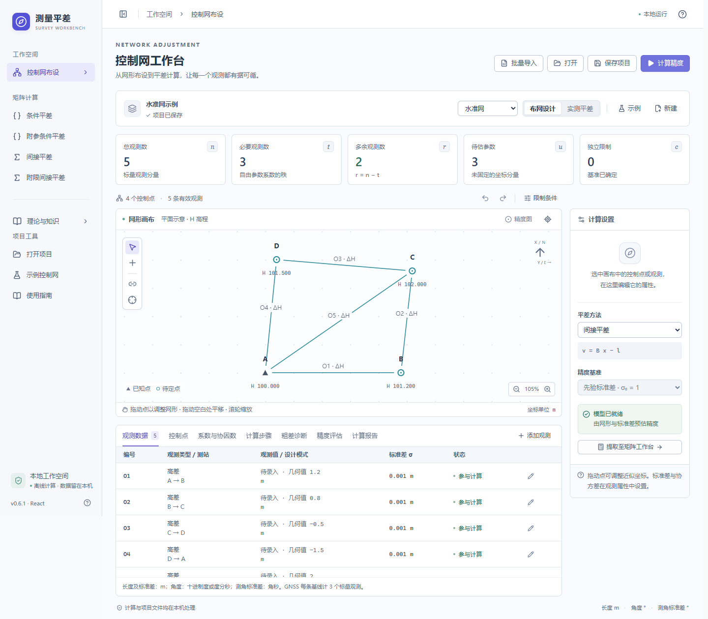

# Maths

数学与测量计算项目。

## 测量平差工作台

[项目源码与使用说明](survey-adjustment-calculator/README.md) · [Windows 便携版下载](https://github.com/HHR-ops/Maths/releases/tag/survey-adjustment-v0.6.1)

基于 React + TypeScript 的本地桌面工作台，支持七类控制网布设、四种平差方法、自动矩阵建模和精度评估。支持 Excel / CSV 批量导入、分步计算、四法对照与统计诊断。v0.6 提供六章十三篇离线理论、交互例题、自测与成果说明入口；v0.6.1 优化文字对比度、按钮轮廓与浅色滚动条。

