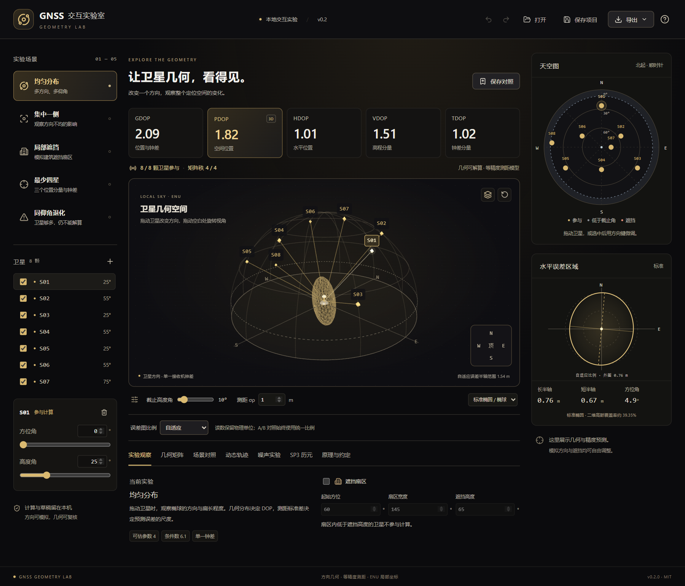

# GNSS 交互实验室 · v0.2.0

以可拖动的卫星方向、动态轨迹和噪声点云，探索卫星几何、DOP 与定位不确定度。本地独立运行，React + TypeScript + Three.js 界面，SVD 数值计算，WebView2 桌面窗口。

## 启动

[下载 v0.2.0 Windows 便携版](https://github.com/HHR-ops/Maths/releases/tag/gnss-geometry-lab-v0.2.0)，版本页提供 EXE、ZIP 和 SHA-256 校验文件。

解压 **GNSSGeometryLab-v0.2.0-Windows-x64.zip**，双击 **GNSS交互实验室-v0.2.0.exe**。

无需 Python 或 Node.js。目标电脑需要 Windows 10/11 x64、.NET Framework 4.6.2 或更高版本，以及 [Microsoft Edge WebView2 Runtime](https://developer.microsoft.com/microsoft-edge/webview2/)。详见 [便携版说明](docs/PORTABLE.md)。

## 功能

- **天空图与三维半球联动**：拖动卫星改变方位角和高度角；方向键微调，支持精确数值输入。
- **实时几何指标**：五类 DOP、参与卫星数、矩阵秩与条件数；几何不可解算时清除旧结果。
- **误差区域**：标准或 95% 水平椭圆、三维椭球；自适应 / 统一固定比例可切换。
- **A/B 同屏对照**：相机联动、相同物理比例与置信设置，显示指标差值；最多保存四组场景。
- **动态轨迹**：独立模拟方向、播放 / 暂停 / 单步、进度滑块、轨迹线与可点击的 DOP 曲线。
- **测距噪声实验**：固定随机种子，生成线性化位置误差点云，比较经验协方差与二维 / 三维理论覆盖率。
- **本地 SP3-c/d**：导入位置历元，设置 WGS84 站点经纬度与椭球高，选择单一星座并逐历元播放。
- **操作细节**：黑金主题、ENU 方向视角、顶视图、编号避让、40 步撤销 / 重做；一次完整拖动对应一次撤销。
- **保存与导出**：兼容 v0.1 的项目 .gnss.json、CSV、三维 PNG、本地自动草稿；可复核 G、Q 与奇异值。

使用示例和边界见 [交互实验指南](docs/EXPERIMENTS.md) 与 [数学模型](docs/MODEL.md)。

## 模型与数据边界

DOP 采用等精度、不相关测距与单一接收机钟差模型。模拟轨迹是教学构造，不是真实轨道预报。噪声实验使用线性化模型，没有生成原始伪距观测、估计真实接收机位置或处理多路径。

SP3 按文件离散历元读取地心坐标，转换为站点 ENU 方向；不插值、不传播轨道、不作时间系统转换或参考框架历元转换。一次只使用一个星座，避免隐含不同系统共用钟差。内置 SP3 示例明确为合成教学数据。RINEX、实时卫星数据与完整定位解算尚未实现。

项目文件保留当前显示帧与对照；轨迹播放状态、噪声样本、完整 SP3、站点输入、相机和显示比例属于当前会话，重新启动后需重新设置或导入。保存 SP3 当前帧后，可以作为普通方向场景继续编辑。

## 常用操作

三维空白处拖动旋转，滚轮缩放；右下角切换 ENU 方位和顶视图。“复位三维视角”返回默认角度。天空图北在上、方位角从北顺时针计。

保存一组对照后再调整卫星或测距标准差，可在“场景对照”中比较。两侧自动共用同一米制误差范围；切换“统一固定比例”可锁定二维、三维与 A/B 范围，超出视窗的内容会裁切。

Ctrl+Z 撤销，Ctrl+Shift+Z 重做，Ctrl+S 保存项目。文本输入框保留其原生编辑撤销。动态实验的“采用当前帧”会结束播放，将此帧加入可撤销的编辑记录。

## 开发与验证

需要 Python 3.13、Node.js 22.12+、npm、WebView2。依赖固定在 requirements.txt 与 frontend/package-lock.json。

    python -m venv .venv
    .venv/Scripts/python.exe -m pip install -r requirements.txt
    cd frontend
    npm ci
    npm test
    npm run build
    cd ..
    .venv/Scripts/python.exe desktop.py

浏览器预览：运行 .venv/Scripts/python.exe desktop.py --serve --port 8891，然后打开终端显示的回环地址。预览不读写桌面草稿。仅开发前端时也可使用 npm run dev。

- **npm test**：24 组计算与数据验证，包含 40 组独立 NumPy 数值参考、噪声协方差 / 覆盖率、轨迹、SP3 和 ENU 校验。
- **npm run test:e2e**：13 组 Edge 流程，覆盖原有操作、撤销、相机联动、统一比例、按需重绘、轨迹、噪声和 SP3 文件导入。
- **.venv/Scripts/python.exe -m unittest discover -s tests -v**：9 组桌面接口检查。
- **desktop.py --ui-self-test qa/native.json**：真实 WebView2、几何指标、实验入口、原生 JSON / PNG 导出与退出检查。
- **powershell -ExecutionPolicy Bypass -File build.ps1**：检查、收集许可并打包 EXE、ZIP 和 SHA-256 校验文件。

固定的 NumPy 参考保存在 frontend/tests/reference.json，运行测试无需 NumPy；它不进入 EXE。三维按需重绘和对象复用已通过场景静止 / 连续编辑检查，未进行跨硬件 FPS 基准测试。

## 许可与参考

原创代码采用 [MIT](LICENSE)，Copyright (c) 2026 HHR-ops。运行组件许可见 [THIRD_PARTY_NOTICES.md](THIRD_PARTY_NOTICES.md)。

数学依据：[ESA Positioning Error](https://gssc.esa.int/navipedia/index.php?title=Positioning_Error)、[ECEF / ENU](https://gssc.esa.int/navipedia/index.php/Transformations_between_ECEF_and_ENU_coordinates)、[IGS SP3-d 格式](https://files.igs.org/pub/data/format/sp3d.pdf)。交互设计参考记录见 [设计说明](docs/DESIGN_NEXT.md)，没有复制参考项目代码或额外引入其运行依赖。
