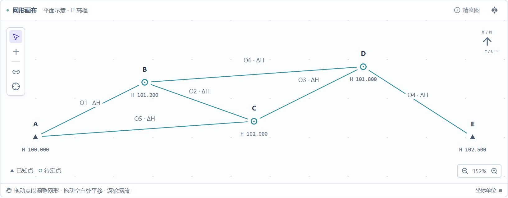
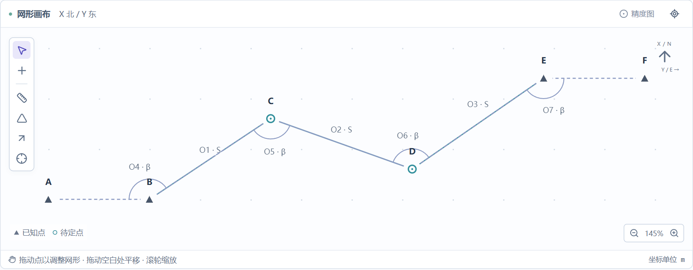
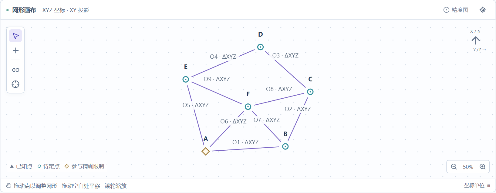
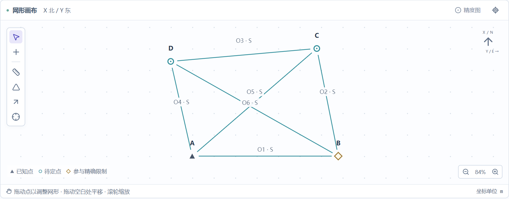
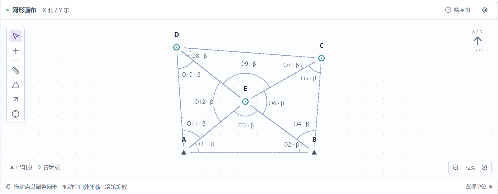
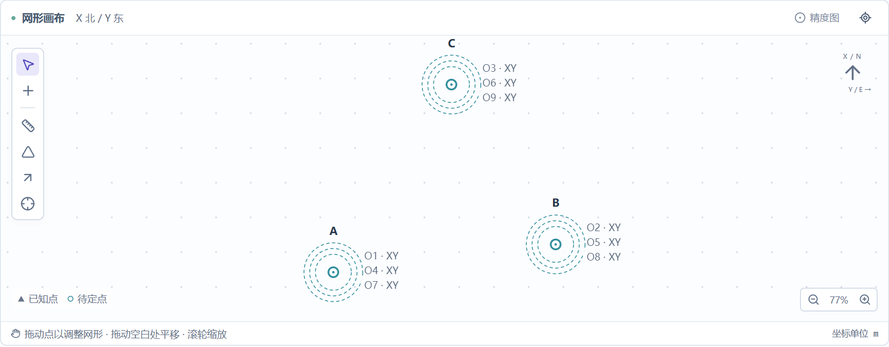

# 七类控制网的典型示例

切换主页“控制网类型”，或点击“示例”，即可载入对应网型。旧版本已保存或恢复的项目保留原数据；需要新示例时主动载入即可。

以下示例采用不同的常见教学网形与观测组合。它们使用模拟坐标和可重复生成的模拟观测，供学习、试算和检查使用。

## 示例与实际统计

| 网型 | 示例 | n | t | r | 参数个数 u | 限制个数 c |
| --- | --- | ---: | ---: | ---: | ---: | ---: |
| 水准网 | 双水准点附合路线与高差检核 | 6 | 3 | 3 | 3 | 0 |
| 导线网 | 两端已知方向边的附合导线 | 7 | 4 | 3 | 4 | 0 |
| GNSS 网 | 六站闭合环与中心基线联测 | 27 | 15 | 12 | 18 | 3 |
| 测边网 | 六条边长构成的大地四边形 | 6 | 5 | 1 | 6 | 1 |
| 测角网 | 四个三角形组成的中心多边形 | 12 | 6 | 6 | 6 | 0 |
| 边角网 | 共用一边的双三角形边角联测 | 11 | 4 | 7 | 4 | 0 |
| 坐标观测网 | 三点、三测回 XY 坐标观测 | 18 | 6 | 12 | 6 | 0 |

统计由实际模型计算，界面不按网型硬编码这些数值。n 统计启用的标量观测分量；t 是消去精确限制后的加权观测系数矩阵秩；r = n−t。所有默认示例的基准亏损均为 0，并支持四种平差方法。

固定坐标直接消去，不计入 u，也不会重复计入 c。c 仅统计额外独立精确限制；因此示例之间的某些统计值相同或 c = 0，都是相应模型的实际结果。

## 各例的观测与基准

1. **水准网**：A、E 高程固定。A–B–C–D–E 为附合路线，另测 A–C、B–D 高差，形成独立检核。
2. **导线网**：A、B、E、F 平面坐标固定，A–B 和 E–F 提供两端方向。观测 B–C、C–D、D–E 三条边及 B、C、D、E 四站转折角。
3. **GNSS 网**：A、B、C、D、E 组成闭合环，F 为中心联测站。9 条三维基线各计 3 个分量，并使用完整相关协方差阵。A 的三个坐标通过三项精确限制引入，因此 u 包含 A 的坐标，c = 3。坐标框架为同一模拟 XYZ 直角坐标框架，不自动转为 ENU。
4. **测边网**：观测四边形四边和两条对角线。A 的 XY 固定，B.X = 0 作为额外方向限制，近似位置选取 A–B 向东的解支；B.Y 仍由观测确定。
5. **测角网**：A–B 为已知基线，中心 E 与四个外点形成四个三角形。只观测各三角形内角，共 12 个角。
6. **边角网**：A–B 为已知基线，ABC 与 ACD 共用 A–C 边。联合观测五条边长和六个内角。
7. **坐标观测网**：A、B、C 的 XY 各观测三测回，直接坐标观测提供位置基准。画布用同心圈和分行标签表示同一点的重复观测，不添加距离或测角连边。

参与精确限制的点以菱形标识；固定坐标点沿用三角形标识。点属性与“限制条件”编辑器可查看具体设置。水平角在测站附近显示圆弧，观测标签避让点名和已有标签。

七种示例的网形预览

**水准网**

**导线网**

**GNSS网**

**测边网**

**测角网**

**边角网**

**坐标观测网**

## 切换、编辑与导入

未修改的自动示例可以直接切换。有编辑的项目会先提示替换，取消时保留当前数据。切换成功后清除旧计算成果，并重新分析模型、适应画布；较早发出的请求晚到时，不会覆盖最新选择。

“布网设计”采用网形与先验标准差预测精度；在“实测平差”模式点击“示例”可载入含模拟观测值的数据。模拟观测使用固定随机种子，便于复核。

Excel 模板在有额外限制时附带“限制条件”工作表。使用 CSV 时，可分别下载点表、观测表和限制表，一起预览导入。限制表每行填写一条与限制编辑器相同的方程，例如 A.X:1 = 0；长度常数采用米。错误数据不会部分写入项目。

## 验证

95 项 Python 测试覆盖七类示例的独立统计预期、四种方法在设计和实测下的一致性、基准限制、停用观测后的计数、含限制的 Excel/CSV 往返和旧四点项目兼容性。17 组浏览器流程覆盖七类网的五项统计、切换顺序、编辑保护与模板导入。打包程序另有 45 项计算冒烟检查和原生窗口检查。

网形选择参考 [USACE 控制测量方法说明](https://www.publications.usace.army.mil/Portals/76/Publications/EngineerManuals/EM_1110-1-1005.pdf)、[NGS 水准测量说明](https://nweb.ngs.noaa.gov/leveling/)；本项目的坐标、观测及统计示例均为自行构造的教学数据。
