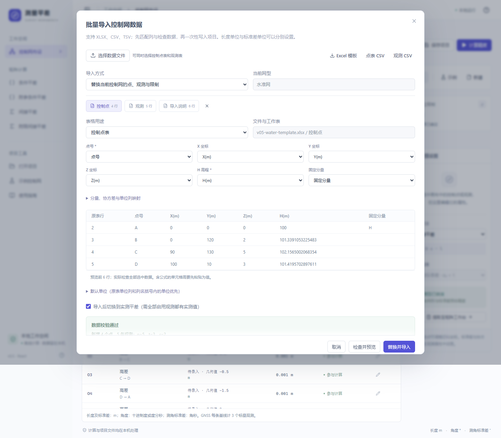
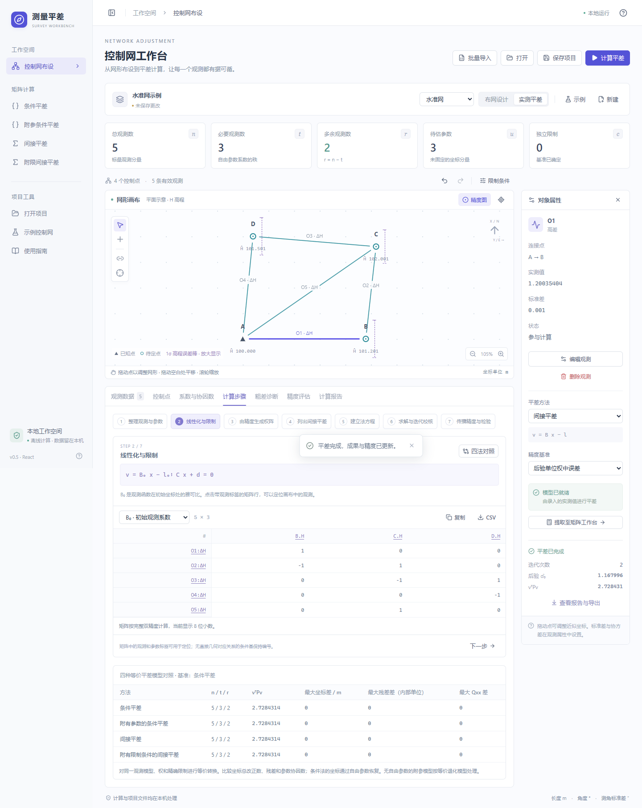
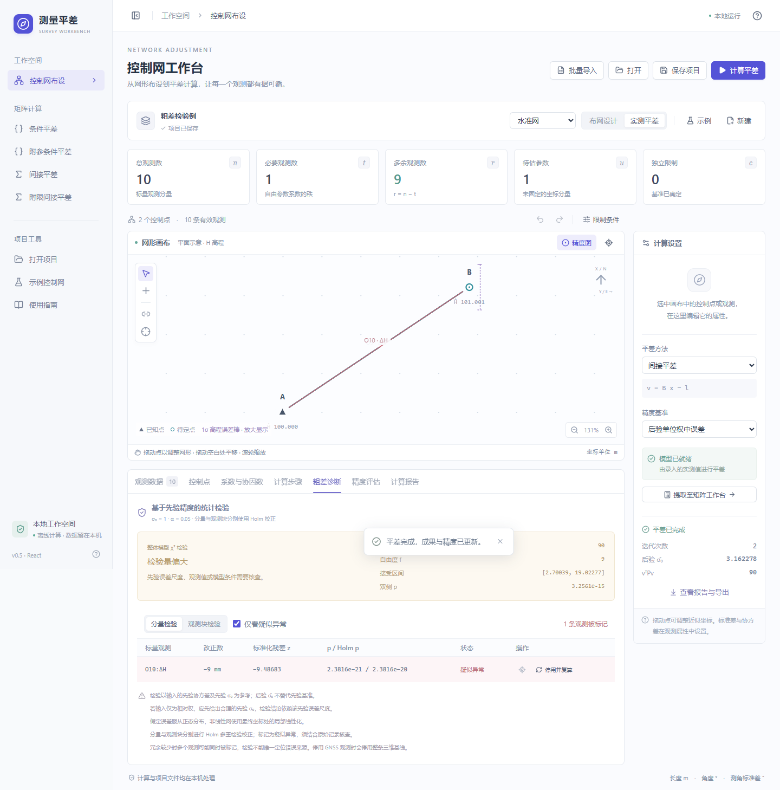

# v0.5：批量导入、分步计算与统计诊断

## 批量导入

点击工作台右上角“批量导入”，支持 `.xlsx`、`.csv`、`.tsv`。旧 `.xls` 需先另存为 `.xlsx`。可一次选择点表和观测表，程序先处理所有点，再处理观测，文件选择顺序不影响点引用。

1. 下载当前网型的 Excel 模板或两种 CSV 模板。模板含可直接计算的示例，请替换为实际数据。
2. 选择文件，逐表确认用途为“控制点表”“观测表”或“忽略此表”。
3. 核对自动匹配的列；自定义表头可手动映射。点名和当前网型的坐标分量为必填项。
4. 核对单位。单位列优先于列名括号内的单位，再优先于界面默认单位。坐标、观测值、标准差、协方差分别转换。
5. 点击“检查并预览”。错误显示文件、表格和原表行号；存在错误时整个导入不写入，不保留部分成功行。
6. 确认追加或替换。替换包括点、观测和精确限制；导入后可用“撤销”恢复。

单文件最大 4 MB，一次最多 40 张表、2000 行；实际控制网仍受 120 点、500 标量观测/参数限制。重复点名不会覆盖。公式单元格需先粘贴为值，导入器不执行 Excel 公式。CSV 支持 UTF-8、GB18030，以及有 BOM 的 UTF-16。

### 单位与 GNSS 协方差

- 长度：m、mm、cm；角度值：deg、rad、dms；角度标准差：arcsec、deg、rad。
- GNSS 基线按 ΔX、ΔY、ΔZ 顺序，也可将三个值写在一个“观测值”单元格。
- 协方差可放在一个多行单元格，或用 Cxx、Cxy、Cxz、Cyy、Cyz、Czz 六列表示。三个对角项必须填写，空缺非对角项视为 0。
- 长度协方差单位可选 m²、mm²、cm²；角度协方差单位可选 rad²、deg²、arcsec²。矩阵必须对称正定。
- 缺少标准差且没有协方差阵时，使用当前观测类型的默认值，并在导入预览中提示。请核对这些值是否适合实际观测。

## 分步计算

控制网计算后，下方“计算步骤”依次展示：整理观测与参数、初始线性化、定权、所选平差模型、法方程、求解与迭代、精度传播。矩阵工作台提供对应的五个线性模型步骤。

显示的法方程供复核，实际计算仍采用白化、SVD 与限制零空间消元。矩阵保留完整数值，界面可复制或导出 CSV。带标签的矩阵行或列可点击定位观测或控制点。条件基通常不对应单一几何环，按编号显示。

有精确限制的附参条件模型使用自由坐标 z，原坐标改正数为 xp + Zz。不能把 z 直接解释成点坐标改正数。迭代表记录每次线性化的最大改正量、改正向量和线性化残差平方和；最终成果按精确观测函数复核。

“四法对照”针对同一观测模型、权与精确限制进行等价转换，比较坐标总改正数、残差与参数协因数。无自由参数或无条件方程的情形按等价退化模型处理。

## 统计检验与疑似粗差

检验假定观测误差为正态分布，且输入的先验协方差模型成立；非线性网采用最终坐标处的局部线性化。默认显著性水平 α=0.05。

- **整体检验**：T=vᵀPv/σ₀²，按自由度 f 的 χ² 分布给出双侧接受区间与 p 值。偏大提示误差尺度、观测值或模型需核查；偏小可能与先验精度偏保守有关。
- **分量检验**：zᵢ=vᵢ/(σ₀√Qvvᵢᵢ)，使用双侧正态 p 值。残差方差相对于输入方差为零或数值上不可分辨时，明确标为不可检验。
- **观测块检验**：使用该块完整残差协方差的有效特征子空间计算联合 χ² 检验。GNSS 三分量按相关观测块处理，不用三个独立阈值代替联合检验。
- **多重比较**：分量列表与观测块列表各自使用 Holm 校正；表格显示原始 p 或校正后的 p。

统计检验始终以先验 σ₀ 为参考，不能用同次残差估计的后验 σ̂₀ 充当独立先验。网络的标准差为实际长度/角度标准差，采用先验 σ₀=1；矩阵工作台使用用户填写的先验 σ₀。若权仅为相对权，应先指定合理的先验尺度。

布网设计没有实测残差；无多余观测时没有检验自由度。这两类情形不提供粗差检验结论。

疑似异常会在表格和画布标记，用户可选择“停用并复算”，比较 n、r、后验 σ̂₀、vᵀPv 和最大点位/高程中误差。GNSS 停用整条三维基线。若停用后基准不足，显示计算错误，可撤销恢复。冗余较少时多个观测可能同时被标记，检验不能唯一确认错误来源。

## 方法参考

- [SciPy χ² 分布](https://docs.scipy.org/doc/scipy/reference/generated/scipy.stats.chi2.html)
- [SciPy 正则化不完全伽马函数](https://docs.scipy.org/doc/scipy/reference/generated/scipy.special.gammaincc.html)
- [GNU Gama 统计分析手册](https://www.gnu.org/software/gama/manual/gama.html)

## 验证

76 项 Python 测试包括既有平差测试及新增加的已知 χ² 分位数、Holm 校正、单个模拟粗差定位、单位不变性、相关 GNSS 块解析解、七类 Excel 模板往返、导入原子性、法方程回代与四法一致性。

10 组浏览器测试覆盖模板下载导入、列映射纠错、结果失效、矩阵标签定位、四法对照、疑似粗差停用与复算比较，以及原有控制网与矩阵流程。打包后另验证 Excel 读写、统计诊断、原生文件导出、步骤面板与正常退出。
