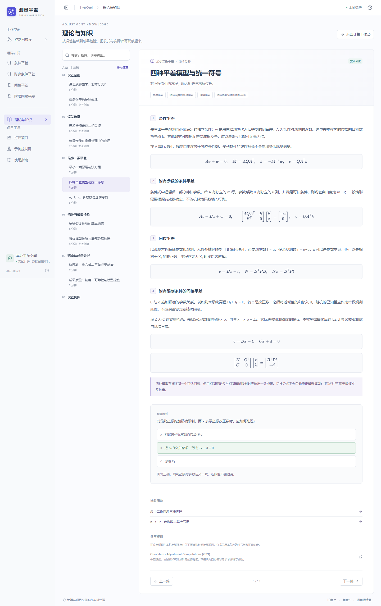

# v0.6 理论与知识

在左侧点击“理论与知识”即可阅读。六章十三篇正文、公式、表格、算例、符号速查与自测题均随程序打包，可以离线使用；只有参考资料的外部原文链接需要联网。

## 知识结构

| 章节 | 内容 |
| --- | --- |
| 误差基础 | 仪器、环境、人员、方法与模型来源；系统误差、偶然误差、粗差；精密度与准确度；正态模型、均值、方差与相关性 |
| 误差传播 | 雅可比与完整协方差传播；一阶近似的条件；高差、加权平均、距离与方位角、相对精度 |
| 最小二乘平差 | 函数与随机模型、法方程、BLUE 条件；四种模型及统一符号；n/t/r、限制秩与基准亏损 |
| 统计与模型检验 | H₀/H₁、α/β、p 值、功效、χ²/t/F 的用途；整体、分量、相关块检验与 Holm 校正 |
| 精度与质量分析 | 协因数与协方差、先验与后验尺度、点位与相对精度、冗余贡献、可靠性与复核顺序 |
| 误差椭圆 | 特征值、半轴、方向、XY 投影；标准椭圆与联合置信域；已知协方差 χ² 倍率与后验尺度 F 倍率 |

全文离线手册见 [THEORY.md](THEORY.md)。它由 tools/build_theory_docs.py 从界面使用的 frontend/src/knowledge.json 生成，便于手工复核和后续统一维护。

## 阅读与计算联动

- 目录按全文关键词搜索；“符号速查”展开与本程序一致的符号表。
- 每篇有一道理解自测，选择后立即给出解释，支持切换文章后返回。
- 控制网的“计算步骤”“系数与协因数”“粗差诊断”“精度评估”旁提供“相关理论”；精度表还可直接打开误差椭圆原理。
- 矩阵结果页提供对应模型、协因数与检验说明入口。打开理论后，当前矩阵结果和控制网成果均保留；点击“返回计算工作台”即可继续。
- 目录下方显示当前**控制网**计算的 n/t/r、精度尺度、整体检验及选中点（或首个有精度的点）的摘要；它不会把矩阵算例冒充为控制网成果。

## 五类交互例题

输入变化后自动重新计算；空值、非法范围或非有限值会报错，旧结果暂时隐藏，避免误读。例题不改变项目数据、精度基准或主画布。

1. **正态区间概率**：改变 k，图中显示 ±kσ 区间及概率。
2. **相关误差传播**：改变两项标准差、相关系数与求和/求差关系，显示方差贡献和交叉项。
3. **三次观测加权平均**：修改观测值与标准差，比较权、改正数、残差平方和及先验/后验均值精度。
4. **整体 χ² 检验**：修改残差平方和、已知先验 σ₀、自由度与 α，查看双侧临界区间、p 值和结论。
5. **椭圆与置信域**：改变 X/Y 标准差、相关系数、精度来源、自由度及标准/95%/99% 显示方式，查看有毫米比例尺的椭圆与半轴数值。

## 解释边界

改正数不等于未知真误差；系统偏差不会仅因重复观测而消失。一般随机误差不必服从正态，精确分布推断需要相应假设。相关观测的传播必须保留交叉项。

整体诊断继续使用已知先验尺度，不把同一组残差估计的后验尺度当独立已知量。t 检验、通用嵌套模型 F 检验和完整内外可靠性指标在知识模块中讲解原理，未冒充为已有诊断功能。

已知协方差的二维正态标准椭圆内部联合概率约为 39.35%，95% 椭圆倍率约 2.447747；后验估计尺度需要提供自由度并使用 F 倍率。主画布仍显示选定尺度下的 1σ 半轴，GNSS 仍是输入 XYZ 框架的 XY 投影。

## 验证

- 87 项 Python 数值与接口测试，含独立闭式参考数值、与现有平差内核的交叉核算和无效输入。
- 14 组 Edge 浏览器测试，覆盖全部文章、公式、检索、自测、五种例题、尺寸适配、返回后成果保留，以及原有七类网和四种方法。
- 37 条正文公式通过 KaTeX 严格渲染检查；公式字体随程序打包，浏览器阅读测试没有外部资源请求。
- EXE 的 45 项计算冒烟检查，以及原生窗口、文件导出、理论阅读、例题与正常退出检查。
